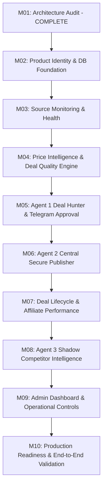

# Architecture Audit & Readiness Report: MetaDeals4U AI Deal Intelligence Platform (M01)

**Audit Date**: 2026-11-08  
**Auditor**: Antigravity Autonomous Orchestrator (Google DeepMind)  
**Execution Context**: Milestone M01 — Pure Read-Only Audit & Baseline Validation  
**Repository Working Branch**: `copilot/overnight-roadmap-2026-11-02`  
**Current Commit**: `a8c6b7e` ("Add Edit and Publish buttons with inline category/merchant selection in Deal Extraction Preview")

---

## 1. Executive Summary & Recommendation

- **M02 Status**: **`READY`**
- **Existing Foundations**: The MetaDeals4U codebase is structurally mature, featuring robust Next.js 16 (App Router), Prisma ORM with 30 schema entities, dual PostgreSQL (port 55432) and MariaDB staging sync, Redis caching (port 6380), an established scraper engine (`src/server/scraper`), product extraction pipeline (`src/server/product-extraction`), and Cuelinks V3 affiliate engine (`src/server/affiliate`).
- **Safety Gate Verification**: Zero application source files, database schemas, or runtime environments were modified during this audit. All findings reflect verified facts from code inspection.

---

## 2. Actual Architecture & Framework Inventory

### 2.1 Frameworks & Runtimes
- **Runtime**: Node.js v24.14.1 (ES2022 target)
- **Web Framework**: Next.js 16.4.3 (App Router with Webpack development server on port 4123)
- **ORM**: Prisma 7.10.1 (with multi-adapter support for PostgreSQL and MariaDB)
- **Database**:
  - Primary Local: PostgreSQL 16 on `127.0.0.1:55432/metadeals`
  - Cloud Staging: Hostinger MariaDB 10.11 on `srv1873.hstgr.io:3306/u113628361_staging`
- **Cache & Key-Value**: Redis 7 on `127.0.0.1:6380`
- **Auth**:
  - Admin: Custom HMAC Session with Argon2id, AES-256-GCM encrypted TOTP, recovery codes
  - Customer: NextAuth.js JWT with Credential (OTP email) + OAuth (Google, Apple, AzureAD, Facebook)
- **Styling / UI**: Vanilla CSS Modules with official `--md-*` design token palette; Lucide React icons

### 2.2 Entity Inventory (30 Prisma Models)
1. **Core Admin & Auth**: `User`, `Account`, `Session`, `VerificationToken`, `AuthSession`, `RecoveryCode`, `AuthToken`, `AuthRateLimit`, `BootstrapState`, `AuditEvent`
2. **Catalog & Taxonomy**: `Category`, `Merchant`, `MerchantWebsiteDirectory`
3. **Deals & Media**: `Deal`, `PurchaseOption`, `Media`, `DealVideoReview`, `YouTubeQuotaLedger`
4. **Shoppers / Customers**: `Customer`, `CustomerIdentity`, `CustomerSignupChallenge`, `CustomerRateLimit`
5. **Affiliates & Monetization**: `AffiliateClick`, `AffiliateTransaction`
6. **Social Distribution**: `DistributionDestination`, `DistributionPost`
7. **Intelligence & Scraper (Existing V1 Foundation)**:
   - `DealCandidate` (`id`, `jobId`, `url`, `title`, `pricePaise`, `rawDiscountPercent`, `brand`, `availabilityStatus`, `verificationStatus`, `confidenceScore`, etc.)
   - `PriceObservation` (`id`, `productId`, `source`, `url`, `pricePaise`, `observedAt`, `dealQualityScore`, etc.)
   - `ScraperJob` (`id`, `connectorId`, `status`, `itemsFound`, `itemsVerified`, `itemsPublished`, `startedAt`, `finishedAt`, etc.)
   - `ProductExtractionLog` (`id`, `url`, `durationMs`, `success`, `error`)

---

## 3. Scraper, Extraction & Publishing Workflow (As-Is)

1. **Extraction Adapters**:
   - `AmazonIndiaAdapter` (`amazon-india.ts`): parses ASIN, MRP, deal price, rating, seller
   - `FlipkartAdapter` (`flipkart.ts`): parses FSN / product ID, prices, specifications
   - `CromaAdapter` / `MyntraAdapter` / `GenericStructuredData`
2. **Scraper Connectors**:
   - `CuelinksFeedConnector`: pulls active retailer campaigns from Cuelinks RSS/API feeds
   - `RetailerGenericConnector`: handles scheduled catalog crawls
3. **Verification Service**:
   - `src/server/scraper/verification.ts` runs automated extraction against retailer URLs, verifies prices, computes baseline confidence, and flags mismatches.
4. **Price History**:
   - `src/server/scraper/price-history.ts` records `PriceObservation` rows in PostgreSQL.

---

## 4. Affiliate Attribution & Monetization Workflow

- **Cuelinks V3 Client** (`src/server/affiliate/cuelinks-client.ts`):
  - Fetches campaign rates, generates tracking URLs, validates merchant approval status.
- **Outbound Redirection** (`src/app/go/[dealId]/route.ts`):
  - Generates sub-id tracking parameters (`subId`), logs `AffiliateClick` records, and redirects shoppers safely to verified affiliate destination URLs without exposing tracking secrets.
- **Admin Dashboard** (`src/app/admin/cuelinks/page.tsx`):
  - Direct conversion tester, merchant payout monitoring, and real-time sub-ID attribution audits.

---

## 5. Architectural Gap Analysis Against Target Platform

| Capability | Current State | Required Target (M02 - M10) | Gap Classification |
|---|---|---|---|
| **Product Master Identity** | Loose title/brand matching in `DealCandidate` | Normalized `ProductMaster` & `ProductVariant` tables with EAN/ASIN/FSN clustering | Additive schema needed (M02) |
| **Source Health & Circuit Breakers** | Basic connector status strings | Automated success/failure health tracking, consecutive timeout circuit breakers | High priority (M03) |
| **Historical Price Intelligence** | Single `observedAt` row; simple average | Append-only 30/90/180/365-day rolling window percentiles, median, all-time-low, fake discount detection | Core Engine (M04) |
| **Agent 1 Deal Hunter & Telegram Approval** | Scraper dashboard review table | Autonomous Hunter + Telegram inline approval bot with signed human approval tokens | Core Agent (M05) |
| **Agent 2 Secure Publishing Engine** | Direct `publishCandidate()` function | Exclusive cryptographic publishing gatekeeper, kill switch, pre-flight stock & coupon verifier | Security Gate (M06) |
| **Deal Lifecycle Monitor** | Soft expiry date check | Active stock & availability polling, automatic delisting upon verified OOS, admin alerts | High priority (M07) |
| **Agent 3 Competitor Intelligence** | None | 100% SHADOW MODE competitor price scraping, matching, and telemetry without publishing authority | Shadow Agent (M08) |
| **Unified Admin Controls** | Dispersed admin tabs | Centralized Operational Cockpit with Agent health, kill switches, and price anomaly controls | Admin Control (M09) |

---

## 6. Additive Schema & Migration Strategy (Safe for Production & Staging)

1. **No Destructive Drops**:
   - Existing `Deal`, `DealCandidate`, `PriceObservation`, and `Merchant` tables will be preserved as the foundation.
   - New models will be added additively:
     - `ProductMaster` and `ProductVariant` (linked optionally to `Deal` and `DealCandidate` via nullable foreign keys).
     - `SourceHealthMonitor` for connector reliability metrics.
     - `TelegramApprovalToken` for cryptographic audit of human approval.
     - `ShadowCandidate` for Agent 3 shadow storage (strictly partitioned from live deals).
2. **Dual Database Parity**:
   - Every Prisma migration will follow the established workflow: dual schema generation (`prisma/schema.prisma` for PostgreSQL and `prisma/schema.mariadb.prisma` for Hostinger MariaDB staging).

---

## 7. M02–M10 Milestone Dependency Roadmap

---

## 8. Verification & Readiness Verdict

- [x] Read-only audit strictly executed with 0 code or database mutations.
- [x] Reusable subsystems identified (`DealManager`, `cuelinks-client.ts`, `verification.ts`, `image-import.ts`).
- [x] Clear additive migration path planned without data loss.
- **Verdict**: **READY to begin Milestone M02 (Product Identity & Database Foundation).**

