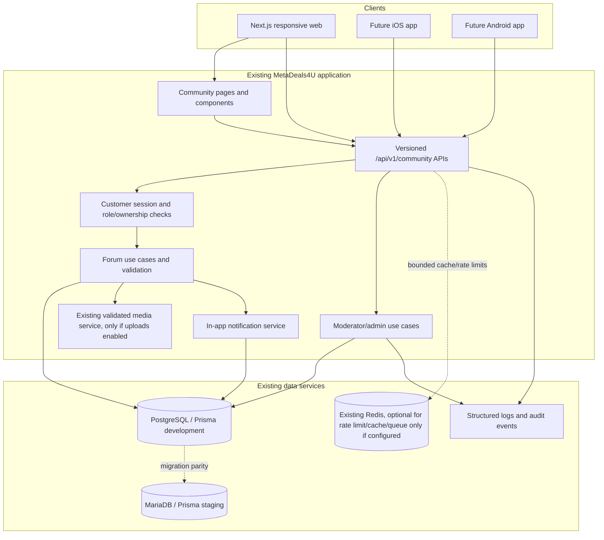

# MetaDeals4U Community Forum — Technical Architecture

## Constraints and fit

- Existing application: Next.js App Router, React, TypeScript, Auth.js/NextAuth customer sessions, Prisma, PostgreSQL development database, MariaDB staging schema, existing admin authorization, media service, and shared design system.
- Use the current application and databases. Do not create a separate forum application, auth system, or database.
- Existing community deal submission/review work is present in the working tree, but it is uncommitted and must be inspected and verified. It represents a separate workflow from general forum content.
- Keep future Android/iOS compatibility through stable, documented HTTP APIs and shared server-side use cases. Avoid making React Server Actions the only interface for core forum operations.
- The project uses Next.js 16 with local agent rules requiring relevant documentation under `node_modules/next/dist/docs/` before editing Next.js code. Read the current local guide.

## High-level architecture

The diagram is logical, not a claim that every component is currently deployed or operational. Use the existing persistence and operations setup discovered in the repository. Redis is optional for MVP only if an equivalent safe rate-limit mechanism already exists; do not add infrastructure without an operations plan.

## Suggested domain model

Names are proposals. Inspect current schema and migrations before adopting them. Existing models may already cover customer deal submissions and should not be duplicated.

### Community

- `Community`: id, slug, displayName, description, icon/media reference, visibility/status, posting policy, creator, timestamps.
- Unique normalized slug; status and visibility indexed.
- Start with admin-managed categories; defer arbitrary user-created communities until governance is established.

### CommunityPost

- id, public stable slug/id, `authorCustomerId`, `communityId`, post type, title, normalized body/markdown source, optional safe external URL, optional `CommunityDealSubmission` or catalog `Deal` reference only if the relation has clear semantics, status, lock state, created/updated/published timestamps, edit version.
- Store price/merchant snapshot only if a deal post needs historical context; label it as user-reported and time-stamped. Do not treat it as verified catalog pricing.
- Avoid copying sensitive user profile fields into post rows.
- Status values should distinguish private draft, review queue, visible, removed, locked, and deleted/tombstoned. Define transitions explicitly.

### CommunityComment

- id, postId, authorCustomerId, nullable parentCommentId, body, status, timestamps, edit version.
- Restrict parent nesting to a small documented depth in the service layer; use indexes for `(postId, createdAt)` and `(parentCommentId, createdAt)`.
- Soft delete/tombstone for threads where appropriate; hide content, preserve minimal structural integrity and moderation evidence under a retention policy.

### CommunityVote

- id, authorCustomerId, target type/id or separate post/comment foreign keys, vote value, timestamps.
- Enforce unique vote per `(authorCustomerId, target)` at the database level. A vote replacement must be atomic and idempotent.
- Prefer separate PostVote and CommentVote tables if polymorphic foreign keys would weaken referential integrity.

### CommunitySave and CommunityFollow

- `CommunitySave`: customer/post unique pair; private to owner.
- `CommunityFollow`: customer/community unique pair.
- Never expose another user’s saved posts through public profile/API.

### CommunityReport and moderation audit

- `CommunityReport`: reporter, target, category, description, status, timestamps, assigned moderator, resolution.
- `ModerationAction` or append-only audit model: actor, action, target, reason, correlation id, timestamp, minimal metadata.
- Ensure moderators see reporter identity only where necessary. Prevent reported user from seeing who reported them unless law/policy requires it.
- Concurrency: state transition uses version/conditional update; only one moderator can win. Audit write and state change happen in a transaction.

### CommunityNotification

- recipient, type, related post/comment/report, readAt, createdAt, dedupe key.
- In-app MVP; email/push is a later opt-in integration with unsubscribe/preferences and delivery logs.

### User submission workflow separation

Use the existing `CommunityDealSubmission` workflow for structured user-submitted deals and admin review, if inspection verifies it. Keep these distinctions:

1. Forum post is community content; its status controls forum visibility.
2. Deal submission is a proposed official catalogue record; it must pass admin review and the existing ordinary deal draft/preview/publish process.
3. Votes, moderator approval of a discussion, or forum visibility must never grant permission to publish an official deal.
4. If a community deal post links to a submission, use an explicit foreign key and state machine; avoid double-posting and ambiguous duplicate representations.

## API surface (candidate contract)

Use current `/api/v1` route conventions and existing customer session helpers. All request bodies need strict Zod validation, bounded lengths, and authorization at the server boundary. Exact routes must be checked for collisions.

### Public read (rate limited)

- `GET /api/v1/community/feed?sort=new|top|hot&community=&type=&cursor=`
- `GET /api/v1/community/communities`
- `GET /api/v1/community/communities/{slug}`
- `GET /api/v1/community/posts/{id-or-slug}`
- `GET /api/v1/community/posts/{id}/comments?cursor=`
- `GET /api/v1/community/search?q=&cursor=` (later if search infrastructure is justified)

Only return published, non-removed content and safe public author fields. Ensure no accidental disclosure of email, profile fields, internal reports, moderation notes, or pending submission data.

### Authenticated customer operations

- `POST /api/v1/community/posts` — create a post; enforce verified/active customer policy, rate limits, duplicate/link checks, and chosen auto-publish/review policy.
- `PATCH /api/v1/community/posts/{id}` — owner-only edit, optimistic concurrency/version checks, defined edit window/policy.
- `DELETE /api/v1/community/posts/{id}` — owner-only removal/tombstone; audit according to retention policy.
- `POST /api/v1/community/posts/{id}/comments` and `PATCH/DELETE /comments/{id}` — authenticated owner scoped.
- `PUT/DELETE /api/v1/community/posts/{id}/vote` and analogous comment vote — idempotent; unique constraints.
- `PUT/DELETE /api/v1/community/communities/{id}/follow`.
- `PUT/DELETE /api/v1/community/posts/{id}/save`.
- `POST /api/v1/community/reports` — authenticated; idempotency/rate limits.
- `GET /api/v1/customer/community/activity` — scoped to current customer; expose counts/statuses from database.

### Moderator operations

- `GET /api/v1/admin/community/queue` and `/reports`.
- `POST /api/v1/admin/community/posts/{id}/approve|remove|restore|lock|unlock`.
- `POST /api/v1/admin/community/reports/{id}/resolve|dismiss|escalate`.
- `POST /api/v1/admin/community/users/{id}/warn|suspend|restore` only for roles explicitly granted.
- Every action requires explicit permission, strict input schema, concurrency checks, transactionally recorded audit, and a user-facing outcome where appropriate.

Do not create broad catch-all public APIs. Use one use-case layer shared by the web UI and any future mobile client.

## Feed ranking and performance

- MVP should use deterministic SQL sorting: new by timestamp/id; top by persisted net score over a selected time window; hot can be introduced with an explainable score and bounded time decay.
- Never calculate feed scores by scanning all posts on each request.
- Use atomic counters or periodic rollups only after correctness is proven. Persist votes as source of truth; periodically reconcile counters if counters are denormalized.
- Use cursor pagination with stable tie-break keys, not unbounded offset pagination for high-volume feeds.
- Query only needed columns and eagerly select bounded author/community fields. Avoid N+1 comment/author lookups.
- Index status+publishedAt, communityId+publishedAt, authorCustomerId+createdAt, postId+createdAt, vote target, report status+createdAt, and normalized URL/hash as appropriate.
- Measure representative query plans and p95 request timings. Add caching only when cache invalidation and user visibility semantics are clear.
- HTML/source sanitization and previews must not run expensive network fetches during feed rendering.

## Security, abuse, and privacy controls

- Authentication does not imply authorization. Every read/write must explicitly check customer ownership or moderator permission.
- Public content APIs serialize an allowlisted DTO, not raw Prisma rows.
- CSRF/origin handling must follow the app’s current Auth.js and API patterns; verify current Next.js 16 docs before changing route mechanics.
- Enforce input size, request body limits, per-account rate limits, safe URLs, and output escaping.
- External product URLs must reject non-HTTPS if policy requires HTTPS, credentials in URLs, local/private IPs, IP literal tricks, unsafe redirects, and non-web schemes. Avoid server-side fetching in forum writes unless a separate SSRF-safe service is used.
- For file uploads, use existing image normalization and storage, validate actual bytes/dimensions, limit size/count, and authorize retrieval. Defer user uploads if this is not ready.
- Minimize personal data in logs and events. No auth tokens, full emails, private content bodies, or secrets in logs.
- Use consent and privacy controls appropriate to the actual cookies/analytics and applicable law. Verify retention, account deletion, moderation evidence retention, and legal holds with counsel.
- Do not add third-party tracker, fingerprinting, user profiling, or AI moderation silently.

## Migration and database strategy

- Inspect PostgreSQL and MariaDB schemas, current migration directories, and uncommitted migration files before creating migration names.
- Additive migrations only. Do not reset databases, edit historical migrations, delete records, or apply schema changes to Hostinger/production.
- Validate migrations on disposable PostgreSQL and MariaDB databases. The owner’s prior authorization allows additive migrations to the local Docker development database, but does not authorize production/Hostinger changes. Confirm whether local persistent DB application is needed after disposable validation.
- Keep schema parity in both configured providers where project deployment requires it. Note provider differences in indexes, JSON, enums, and transaction semantics.
- Generate Prisma clients only after schema review; generated code may be ignored/tracked in this repository, so inspect status first.

## Observability and operational controls

- Structured event names: `community.post.created`, `community.post.removed`, `community.comment.created`, `community.report.created`, `community.moderation.action`, `community.vote.changed`, `community.notification.created`.
- Include request/correlation ID, actor type/id (pseudonymous where feasible), target id, result, duration, and reason code. Minimize text and personal data.
- Operational dashboard: queue age, open reports by severity, failed writes, moderation actions, rate-limit rejections, p50/p95 API latency, and database error rates. Metrics are real aggregates, never hardcoded sample counts.
- Establish response ownership and escalation for urgent reports before public launch.

## Test matrix and launch gates

### Unit/service

- Post/comment validation and status transition tables.
- Vote create/change/remove correctness and duplicate races.
- Feed ranking stable ordering and time windows.
- URL normalization/SSRF rejection cases.
- Moderation permission matrix and audit content.

### API/database integration

- Anonymous can read only published posts; cannot create/vote/comment/report when account is required.
- A customer cannot read/edit/delete another customer’s private or draft content, saved items, reports, or submissions.
- Public DTO excludes private profile and moderation fields.
- Concurrent duplicate posts/votes/reports are handled consistently.
- Moderation approval/removal is atomic with an audit event; race loses safely.
- A forum post can never publish an official deal. Official deal publication remains through existing permissions and preview workflow.
- PostgreSQL and MariaDB migration/schema behavior validated on disposable databases.

### End-to-end workflows

1. Guest browses public community feed and post detail.
2. Verified customer creates discussion, edits, comments, receives replies, saves, follows, and deletes/removes own post.
3. Customer submits a deal; status remains private/pending until the existing admin review path handles it; if converted, official deal remains draft until normal publication.
4. User reports content; moderator triages and takes action; reporter receives outcome where policy says.
5. Suspended user cannot post/comment/vote or bypass via API.
6. Mobile viewport and keyboard/screen-reader flows for post creation, reporting, and moderation.

### Performance

- Test feed with realistic seeded disposable records and query plans.
- Define p95 targets before calling performance complete; no hardcoded benchmark claims.
- Test rate limit and queue behavior under concurrent requests.

## Rollout / feature flags

- Start behind a server-side feature flag or private staging access, if the existing configuration supports it.
- Enable read-only community first, then posting to a limited pilot, then voting/notifications as policy and moderation staffing are ready.
- Have a clear kill switch that disables creation and interaction while leaving safe read-only content available where appropriate.
- Never expose moderator APIs or controls solely by hiding frontend navigation.
