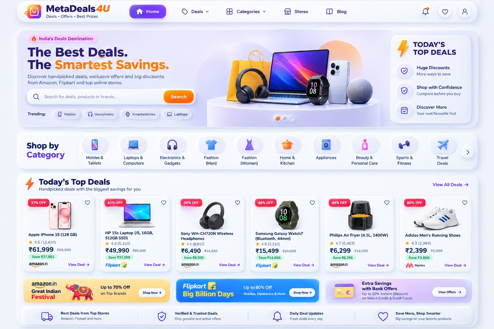
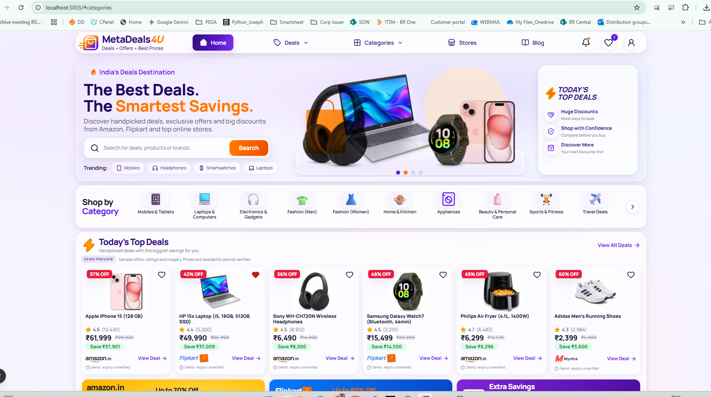

# M1.5 — Homepage Design Finalization

## Objective

Refine the existing MetaDeals4U homepage to match the latest user-approved glassmorphism reference. This is a visual refinement, not a replacement application or redesign from scratch.

## Before coding

* Inspect the current homepage, components, global CSS, Tailwind configuration and font setup.
* Inspect existing brand tokens and determine whether `metadeals4u-color-system.css` is already integrated.
* Identify hardcoded colors and duplicated tokens.
* Preserve all existing routes, search/filter interactions and demo labels.

## Design requirements

* Use Manrope via the existing font setup or `next/font/google` if not already configured.
* Weights: 400, 500, 600, 700, 800.
* Soft pink, lavender, purple and blue ambient gradient background, used with restraint.
* Frosted-glass header and content panels.
* Translucent search surface and trending chips.
* Rounded category icon containers.
* Six deal cards per row on wide desktop where space allows.
* Promotional banners and benefits strip retained.
* Purple primary actions and orange highlights.
* Subtle borders, soft shadows and restrained backdrop blur.
* Product cards remain readable and mostly opaque.
* Maintain strong text contrast and visible focus states.

## Responsive requirements

Validate at 1536px, 768px, 390px and 320px:

* No page-level horizontal overflow.
* Header/navigation adapts to mobile.
* Categories are horizontally scrollable where needed.
* Deal grid adapts to available width.
* Product names/prices/buttons remain readable.
* Hero content stacks or rearranges cleanly.

## Functional preservation

Do not remove or break:

* Search
* Category/store filters
* Featured/latest views
* Wishlist interactions if implemented
* Existing links and navigation
* Demo offer labels

## Acceptance checks

* Compare screenshots against the attached approved reference.
* Run lint, type-check, tests and production build using existing scripts.
* Run available browser/smoke checks.
* Report visual differences and any unresolved issues honestly.

# MetaDeals4U – Reference-Based Homepage Visual Refinement

## Objective

Refine the existing MetaDeals4U homepage to closely match the attached approved reference screenshot.

The reference screenshot is the primary visual specification. The currently developed website is the implementation to be improved.

Do not simply make minor CSS adjustments. Compare both screenshots carefully and correct the differences in visual proportions, spacing, typography, colors, grids, card dimensions and overall presentation.

The goal is to achieve the same look and feel as the reference while preserving all existing working functionality.

## 1. Overall visual theme

Adopt a premium, clean, light-blue glassmorphism design.

The current implementation has too much pink/purple tint in the page background. Replace this with a very light blue background similar to the reference.

Use these design tokens:

- Page background: #F1F5FF
- Secondary background: #F7F9FF
- Surface/card background: #FFFFFF
- Light blue accent: #E9EEFF
- Deep purple: #321078
- Royal purple: #641BE5
- Orange: #FF7A00
- Primary text: #17172F
- Secondary text: #53617F
- Border: subtle blue-grey
- Font: Manrope

Preserve the established MetaDeals4U brand identity.

Use purple for navigation, headings, links and icons. Use orange for primary actions, savings highlights and promotional accents.

Do not use a strong pink background or excessive purple gradients.

## 2. Overall page width and proportions

The current website content is too narrow compared with the reference.

Increase the main content width to approximately 94% of the available desktop viewport.

Use a responsive max-width appropriate for large monitors, with consistent horizontal margins.

The header, hero, category section and deal listing should align to the same overall content width.

Match the reference's generous spacing and proportions.

Avoid unnecessarily large empty margins on either side.

## 3. Header and navigation

Match the reference header:

- Wide, rounded navigation container.
- White/light-blue frosted surface.
- Soft blue-grey shadow.
- MetaDeals4U logo and tagline on the left.
- Home, Deals, Categories, Stores and Blog navigation.
- Notification, wishlist and profile icons on the right.
- Purple active navigation state.
- Consistent icon size, alignment and spacing.

Keep the header responsive and preserve existing navigation behavior.

## 4. Hero section

Match the reference hero section's dimensions, layout and visual hierarchy.

- Large rounded container with a subtle light-blue surface.
- Left-side headline and description.
- Bold Manrope typography.
- Purple and orange headline emphasis.
- Search input with orange search button.
- Trending category chips.
- Large product showcase imagery on the right.
- Today's Top Deals information panel on the far right.

Ensure that the hero is spacious and not compressed.

Preserve the existing carousel functionality and search behavior.

## 5. Shop by Category

Match the reference category section:

- Horizontal category layout.
- Larger circular or pill-shaped icon containers.
- Soft shadows and subtle blue borders.
- Clear category labels.
- Consistent icon dimensions.
- Horizontal navigation control.

Ensure all category items remain accessible on smaller screens.

## 6. Today's Top Deals grid

This section requires particular attention.

At the reference desktop width, display six deal cards per row.

Match the reference card dimensions and proportions:

- White/light surface.
- Subtle blue-grey border and shadow.
- Rounded corners.
- Product image area with consistent height.
- Discount badge in the upper-left corner.
- Wishlist icon in the upper-right corner.
- Product title with consistent typography.
- Rating and review count.
- Current price in bold.
- Original price with strikethrough.
- Green savings badge.
- Store logo/name.
- View Deal action.

Ensure cards have consistent alignment and height.

Avoid making cards too narrow or reducing product image visibility.

Do not change deal data, affiliate URLs or existing wishlist functionality.

## 7. Promotional banners

Preserve the three promotional banner positions and their content:

- Amazon promotional banner.
- Flipkart promotional banner.
- Bank offers banner.

Match the reference's horizontal dimensions, rounded corners, height and visual prominence.

Use the appropriate orange/yellow, blue and purple promotional colors.

## 8. Bottom confidence/value section

Preserve the four feature messages:

- Best Deals from Top Stores.
- Verified & Trusted Deals.
- Daily Deal Updates.
- Save More, Shop Smarter.

Match the reference's white/light-blue surface, icon size, spacing and separators.

## 9. Typography

Use Manrope consistently across the entire homepage.

Match the reference hierarchy:

- Large bold hero headline.
- Strong section headings.
- Medium-weight product titles.
- Clear price hierarchy.
- Readable secondary information.
- Consistent navigation font sizes.

Avoid excessively small text and inconsistent font weights.

## 10. Shadows, borders and glassmorphism

Use subtle, premium styling.

- Soft blue-grey shadows.
- Light borders.
- Moderate backdrop blur where appropriate.
- White surfaces with high text contrast.
- Consistent border radius.

Do not apply strong blur or transparency to product cards where it reduces readability.

Do not overuse gradients.

## 11. Responsive behavior

Match the reference at desktop sizes while preserving responsive layouts.

- Desktop: six deal columns where space permits.
- Tablet: three columns.
- Mobile: two columns where readable.
- Very narrow screens: one column if necessary.

Avoid horizontal overflow.

Maintain the same visual identity across all breakpoints.

## 12. Existing functionality must be preserved

Do not break:

- Homepage search.
- Category navigation.
- Store navigation.
- Deal links.
- Wishlist.
- Notifications.
- Hero carousel.
- Infinite scrolling, if implemented.
- Existing API integrations.
- Authentication functionality.

Do not replace working components with static mockups.

## 13. Implementation approach

Before making changes:

1. Inspect the existing project structure.
2. Identify global CSS and design tokens.
3. Identify homepage components and their styling.
4. Review the existing brand color stylesheet.
5. Compare the implementation against the supplied reference screenshot.
6. Identify hardcoded colors, widths, spacing and font sizes that cause visual differences.

Centralize design tokens instead of adding scattered CSS overrides.

Avoid duplicating styles or introducing unnecessary dependencies.

Do not redesign unrelated pages in this task.

## 14. Visual validation

After implementation:

1. Run the application locally.
2. Capture a screenshot at 1536 × 1024.
3. Compare it against the approved reference screenshot.
4. Check the overall page width, background color, hero proportions, category layout and six-column deal grid.
5. Validate responsive layouts at 768px, 390px and 320px.
6. Fix visible alignment, spacing and overflow issues.
7. Run lint, type-check, tests and production build.

If any ordinary validation issue remains, document it rather than abandoning the entire task.

## 15. Completion report

Create a report documenting:

- Files changed.
- Design tokens updated.
- Components refined.
- Before/after visual differences.
- Screenshot locations.
- Responsive validation results.
- Lint, test and build results.
- Outstanding issues.

## Final acceptance criteria

The developed homepage should visually resemble the approved reference screenshot, particularly in:

1. Very light blue page background.
2. Wide, spacious page layout.
3. Manrope typography.
4. Premium glassmorphism styling.
5. Consistent purple and orange brand accents.
6. Large hero and category sections.
7. Six-column desktop deal grid.
8. Clean white product cards.
9. Properly aligned promotional banners.
10. Consistent spacing, shadows and rounded corners.

The reference screenshot takes priority over the current implementation wherever their visual styling differs.

Do not deploy or perform production changes.

Reference Image for Development 
Developed Wesbsite 

# MetaDeals4U – Homepage Infinite Scroll Enhancement

Implement infinite scrolling on the homepage deal listing.

## Reference

Use the attached homepage screenshot as the visual reference. Preserve the existing approved MetaDeals4U glassmorphism design, colors, Manrope typography, deal cards, promotional banners and responsive layout.

## Functional requirements

1. Initially load the first batch of deals from the backend.

2. Use the Intersection Observer API to detect when the user approaches the bottom of the deal listing.

3. Automatically request the next batch of deals.

4. Append the results to the existing deal grid without replacing previously loaded deals.

5. Use cursor-based pagination through the API. Do not fetch the entire database into the browser.

6. Prevent duplicate API requests while a request is in progress.

7. Prevent duplicate deal cards using unique deal IDs.

8. Preserve active search terms, category filters, store filters and sorting when requesting subsequent batches.

9. Reset the cursor and loaded results when the user changes the search or filters.

10. Display skeleton deal cards while loading additional results.

11. Display a clear end-of-results message when no more deals are available.

12. Provide a retry action if an API request fails.

13. Ensure the implementation is responsive and performs well on desktop and mobile.

## Backend and API

- Inspect the existing Prisma schema and deal APIs before making changes.

- Implement or extend cursor-based pagination as required.

- Return the deal records, next cursor and has-more indicator.

- Apply filtering and sorting consistently across all batches.

- Use stable sorting with a unique ID as a tie-breaker to prevent missing or repeated deals.

## Performance and quality

- Avoid unnecessary API calls.

- Clean up the Intersection Observer when the component unmounts.

- Handle loading, empty, error and end-of-results states.

- Preserve the initial server-rendered homepage content where applicable for SEO.

- Do not introduce numbered pagination on the homepage.

- Do not change unrelated components or redesign the existing homepage.

## Acceptance criteria

- Opening the homepage loads the first batch.

- Scrolling down automatically loads additional deals.

- Existing deals remain visible while new deals load.

- No duplicate cards appear.

- Search, category and store filters work with infinite scrolling.

- Loading and error states are visually consistent with the existing design.

- No horizontal overflow or layout breakage on mobile.

- Existing tests continue to pass.

After implementation, run the relevant lint, type-check, test and production build checks. Document all changed files, API changes, test results and any outstanding issues in the module completion report.

## Out of scope

No database changes, authentication implementation, affiliate integrations, messaging integrations or production deployment.

